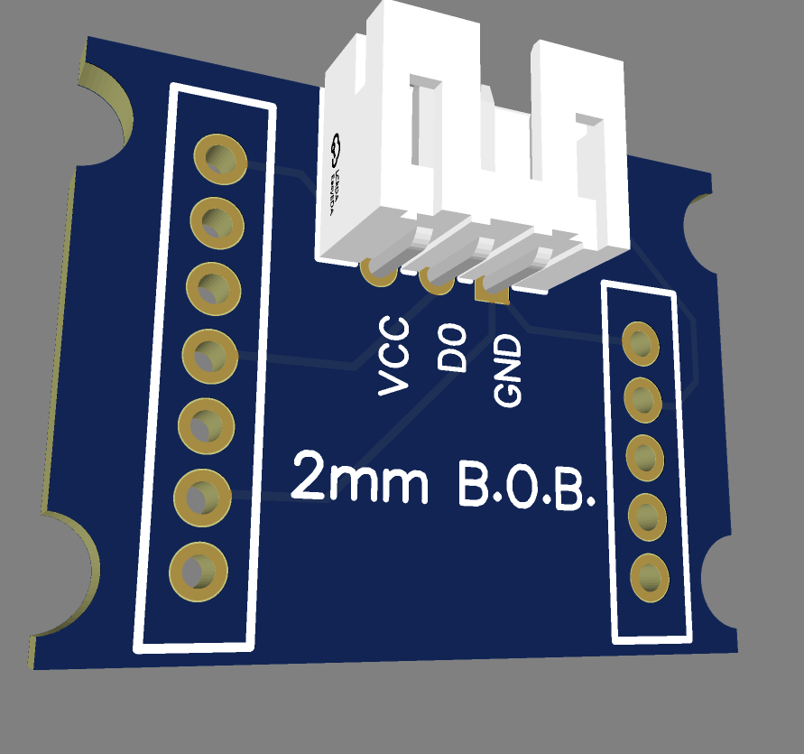
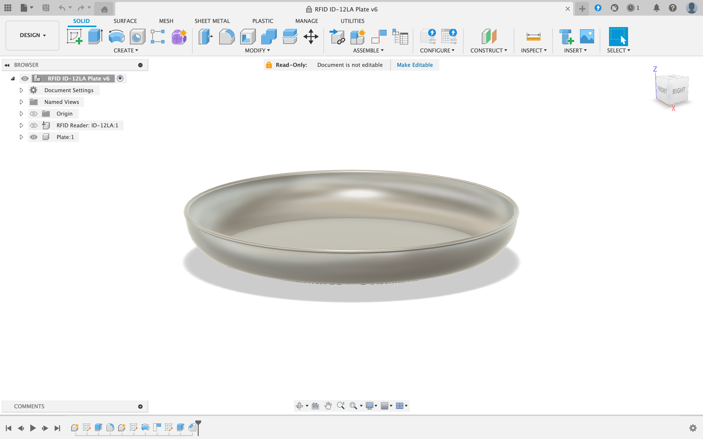

# BALANCING SCALE
A pendulum scale that is part of the pirate shiproom prop.
Players balance spice pouches against coins.
The scale uses RFID to identify the pre-designated items placed on its two plates, rather than measuring actual weight, and a servo moves the needle to show the result.

Current firmware: **v1.4.9** (`Code/BalancingScale/BalancingScale.ino`). Device details for WatchTower are in `Code/BalancingScale/MANIFEST.h`.

## Controller
The controller is a classic ESP32 with a CP210x USB bridge. It reads both plates, runs the puzzle, moves the needle and talks to the room over Wi-Fi and MQTT. Build it as `esp32:esp32:esp32`.

## RFID Readers
Each plate has one multi-tag RFID reader. Both run at 115200 baud on a hardware UART and use the 0xF5-frame command protocol. A reader can see at most 5 tags at once, and tag IDs are 4 bytes.

These are not the ID-12LA readers from the original build: an ID-12LA only outputs one tag at a time and cannot answer these commands.

## Pins
| GPIO | Function |
|---|---|
| 18 / 19 | Spice plate reader, ESP32 RX / TX (UART1) |
| 16 / 17 | Coins plate reader, ESP32 RX / TX (UART2) |
| 13 | Needle servo (500-2400 us, 100 Hz) |

There are no buttons or LEDs. Reset and solve are MQTT commands, and the needle is the indicator.

## Breakout Board
A custom printed circuit board designed for the original ID-12LA readers, which have 2mm pitch pins. Its Gerber files are in `Docs/Fabrication Files`. The firmware does not show whether it is still in use on the prop. 

## 3D Models
The RFID reader cannot properly broadcast a signal through metal plates, so a 3D model was designed for the plate. Within the plate design, a guide for the RFID cover housing is attached underneath the plate. The RFID readers sit under the plates and should not be exposed, so a cover housing was designed. They are connected to the plate using screws.

## Puzzle
Each item has a represented weight.

| Spice pouch | Value |
|---|---|
| Yeast | 2.50 |
| SugarCane | 2.25 |
| Vanilla | 1.75 |
| Molasses | 2.75 |
| Cloves | 1.50 |

There are 8 coins, two of each type:

| Coin | Name in code | Value |
|---|---|---|
| Gold | GoldDoubloon | 1.00 |
| Silver | PieceOfEight | 0.75 |
| Copper | HalfDoubloon | 0.50 |
| Bronze | QuarterDoubloon | 0.25 |

## Algorithm
About once a second the board does the following:
1. Scan the spice plate and the coins plate.
2. Add any valid tag that is not already stored for that plate. Ignore unknown tags.
3. Remove a stored tag only after 3 missed scans in a row, so a single dropped read does not move the needle.
4. If either plate is empty, move the needle to center (1566 us, about 101 degrees).
5. If both plates are loaded and the values differ, move the needle to NAY (30 degrees).
6. If the values are equal, move the needle to YAY (155 degrees). If the value belongs to a spice not yet matched, mark it matched and publish it.
7. When all 5 spices are matched, publish `SOLVED`. Scanning continues, so the needle still returns to center when the plates are emptied.

## MQTT
Broker: `10.1.10.115:1883`, Wi-Fi network `AlchemyGuest`.

| Topic | Direction | Payload |
|---|---|---|
| `MermaidsTale/BalancingScale/command` | Subscribe | `PING`, `STATUS`, `RESET`, `PUZZLE_RESET`, `SOLVE`, `HALTCOIN`, `HALTSPICE`, `REBOOTCOIN`, `REBOOTSPICE`; tuning only: `SERVO_TEST:angle`, `SERVO_US:microseconds` |
| `MermaidsTale/BalancingScale/command` | Publish | `PONG`, `OK` |
| `MermaidsTale/BalancingScale/status` | Publish | `ONLINE` (retained), `OFFLINE` (retained, last will), `SOLVED` (not retained), heartbeat every 5 minutes, `STATUS` reply |
| `MermaidsTale/BalancingScale/log` | Publish | Boot line (includes `RESET:reason`) and log text |
| `MermaidsTale/BalancingScale/message/SuccessCount` | Publish | Spices matched so far |
| `MermaidsTale/BalancingScale/message/servo`, `/message/ServoState` | Publish | `yay` / `nay`; `true` / `false` |
| `MermaidsTale/BalancingScale/message/Spice`, `/message/UID0-4` | Publish | Tag just read |
| `MermaidsTale/BalancingScale/{Yeast,SugarCane,Vanilla,Molasses,Cloves}` | Publish | `true` when that spice is matched |
| `MermaidsTale/BalancingScale/system/...` | Publish | Plate weights, stored tags, needle center |

M3 matches `SOLVED` on `/status` and forwards `MermaidsTale/ScaleSolved=true`. M3 also reads `/message/SuccessCount` and sends `PUZZLE_RESET` on the story reset.

`PUZZLE_RESET` clears both plates and all progress without a reboot. `RESET` reboots the board.

## Self-Recovery
| Trigger | Action |
|---|---|
| Wi-Fi not joined in 20 s, or lost for over 20 s | Reboot |
| Broker unreachable for 60 s with Wi-Fi up | Reboot |
| Main loop stalled for 30 s | Watchdog reboot (boot line shows `RESET:TASK_WDT`) |

## Over-the-Air Updates
OTA is on: hostname `BalancingScale`, port 3232, and the password is the Wi-Fi password. Build with an explicit `--build-path` and upload with `--input-dir`, because uploading from a sketch path once sent a stale cached build to the board.
